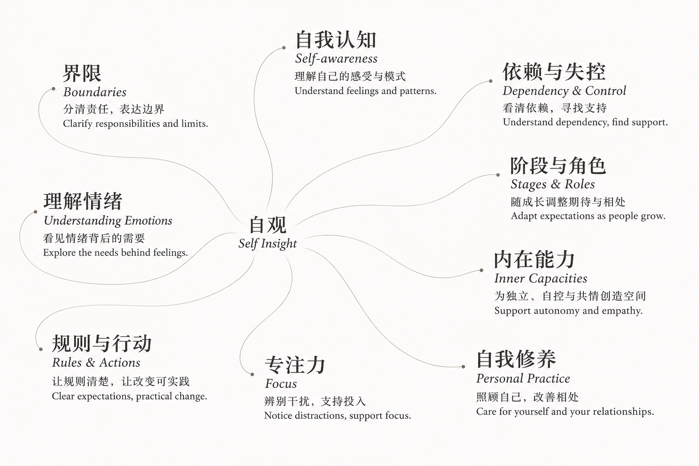

# Self Insight · 自观

[中文](README.md)

Explore your feelings, relationships, and recurring patterns through a focused conversation. Describe what is troubling you; the router selects a relevant module instead of handing you a long generic answer.



## What it does

Self-awareness and boundaries are available beyond parenting. Seven additional modules address specific parenting and caregiver concerns. A broader display name does not change a module's audience or turn it into adult therapy.

The router chooses one lead module and at most two supporting modules. It carries known facts across the conversation and does not assume every personal difficulty comes from family history.

## Install the complete package

Use an AI tool that supports Agent Skills, with Node.js and npx available.

```sh
npx -y skills add Ptothez/self-insight-skill --skill '*'
```

This selects the main entry and all nine modules. Follow the installer prompts to select your Agent and installation scope. Install the main entry as well as the modules; the installer does not supply an AI account or model credits.

Start with `self-insight` or ask:

> Use Self Insight to help me explore why I keep agreeing to requests and regretting it later.

This is a fictional, generic example, not a real user's story.

## Modules

| Module | What it helps explore |
| --- | --- |
| Self-awareness / 自我认知 | Self-evaluation, feelings, and recurring patterns |
| Boundaries / 界限 | Responsibilities, saying no, and relationship limits |
| Understanding Emotions / 理解情绪 | A caregiver's response to a child's feelings |
| Rules & Actions / 规则与行动 | Clear, proportionate parenting expectations |
| Dependency & Loss of Control / 依赖与失控 | Everyday family support around a child's dependency concerns |
| Stages & Roles / 阶段与角色 | Expectations suited to a child's developmental stage |
| Inner Capacities / 内在能力 | Supporting autonomy, self-regulation, empathy, and learning |
| Personal Practice / 自我修养 | A parent's self-care, communication, repair, and cooperation |
| Focus / 专注力 | Distinguishing attention difficulties from expectations and context |

README files, module names, and the overview graphic are bilingual. Detailed operational guides are mainly in Chinese; the Agent is instructed to respond in the user's language. This is not a claim that every internal reference is translated.

## Privacy and limits

The release includes functional guides for all nine modules, not a mirror of any private knowledge base. It contains no real case histories, private chats, course transcripts, lesson-by-lesson notes, credentials, or personal configuration.

There are no background services, upload scripts, or automatic case-recording features. Your AI client and model provider determine where conversations are processed and stored.

This is an AI reflection aid, not psychological diagnosis, treatment, or a replacement for qualified care. There are no promises of outcomes or clinical efficacy.

## Upgrade

The previous repository was named `family-mentor-skill`; its public package included only the entry and self-awareness module. Install the new package, verify it works, then use your Skill manager to remove the old `family-mentor` and `family-mentor-self-awareness` installations. Existing installations do not update automatically.

## Structure and license

`skills/self-insight/` is the router; the other nine `skills/self-insight-*/` directories contain real module guides. Keep all ten installed together.

See [LICENSE](LICENSE) and [publication scope](PUBLICATION.md). The repository license does not grant rights to third-party courses or private source materials.
