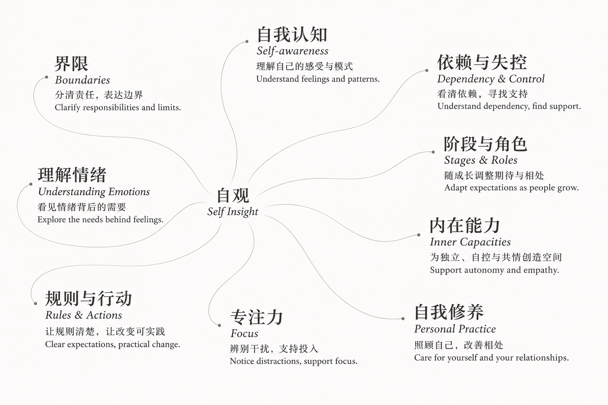

# 自观 · Self Insight

[English](README.en.md)

理解自己的感受、关系与行为。说出困扰，由 AI 选择适合的方向，和你逐步梳理，而不是一次给你一长串答案。



## 能做什么

- **自我认知、界限**：不必是父母，也可以谈自我评价、反复出现的关系模式、责任与拒绝。
- **养育与个人成长**：理解情绪、规则与行动、依赖与失控、阶段与角色、内在能力、自我修养、专注力各有具体范围。涉及儿童的模块仍以儿童与照护者为对象，不因为名称更通用就变成成人治疗。
- **模块协作**：一次以一个模块为主，必要时请最多两个辅助；不重复询问已经说过的事情，不假定所有个人问题都来自家庭。

## 完整安装

需要支持 Agent Skills 的 AI 工具，以及 Node.js / npx。

```sh
npx -y skills add Ptothez/self-insight-skill --skill '*'
```

这会选择主入口及全部九个模块；安装器随后让你选择 Agent 和安装范围。不要只装自我认知而漏掉共享入口。安装器不会提供 AI 账号或模型额度。

安装后使用「自观」或 `self-insight`，也可以直接说：

> 用自观帮我梳理：我常常答应别人，事后又很不情愿。我想知道自己为什么这么难拒绝。

以上是虚构的通用使用示例，不是作者或用户的真实经历。

## 九个模块

| 模块 | English | 用途 |
| --- | --- | --- |
| 自我认知 | Self-awareness | 梳理自我评价、当下感受与反复出现的关系模式。 |
| 界限 | Boundaries | 厘清责任、拒绝与关系中的安全边界。 |
| 理解情绪 | Understanding Emotions | 帮助照护者理解和回应孩子的情绪。 |
| 规则与行动 | Rules & Actions | 帮助父母澄清管教目标，落实清楚且适度的规则。 |
| 依赖与失控 | Dependency & Loss of Control | 理解儿童依赖行为带来的影响，探索家庭层面的支持。 |
| 阶段与角色 | Stages & Roles | 帮助父母按孩子的发展阶段调整期待与相处方式。 |
| 内在能力 | Inner Capacities | 帮助照护者支持孩子的独立、自控、共情和学习等内在能力。 |
| 自我修养 | Personal Practice | 帮助父母从自身状态与相处方式入手，而非只要求孩子改变。 |
| 专注力 | Focus | 帮助照护者区分儿童专注困难、期待与环境因素。 |

## 隐私、来源与范围

本包包含主入口、九个可运行的模块指南与共享对话规则，不包含私人知识库、真实案例、课程原文、逐课讲义、账号或聊天记录。它是经过公开范围审查的功能包，**不是私人资料库的完整镜像**。

没有后台服务、上传脚本或自动记录功能；实际对话是否送往云端由你使用的客户端和模型服务商决定。不要输入不必要的可识别信息。

内容支持自我探索与日常养育讨论，不提供心理诊断或治疗，不替代专业服务，不保证某种结果。具体适用范围以各模块说明为准。

## 从旧版本升级

此前仓库名为 `family-mentor-skill`，旧公开包只有主入口和自我认知。现在使用 `self-insight` 主入口与九个模块。旧安装不会自动升级：请安装本版本，确认可用后，用你的 Skill 管理器移除旧的 `family-mentor` 和 `family-mentor-self-awareness`，避免同名用途重复触发。

## 文件与许可

`skills/self-insight/` 是主入口；其他九个 `skills/self-insight-*/` 是子模块。每个模块均含 `SKILL.md` 和实际使用指南；必须连同主入口安装。

仓库许可见 [LICENSE](LICENSE)，适用于本仓库可授权的内容，不授予任何第三方课程或私人材料的权利。发布边界见 [PUBLICATION.md](PUBLICATION.md)。
